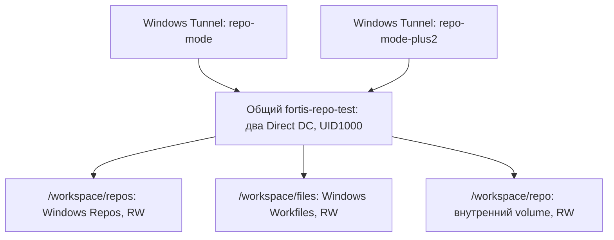

# Безопасность и изоляция Fortis Repo / Tunnel

**Текущий функциональный инцидент:** 26.10.2026, WF-055–058 — Repo1 quiet canary прошёл ограниченный live smoke, Repo2 и постоянный default ещё не восстановлены; V-16/F-R-15. Последняя ассистентская Linux confinement-проверка — WF-054; owner проверил новый временный Direct MCP в WF-055. Это разные scoped observations, не непрерывная аттестация.

## 0. Назначение и действующее ограничение

Это единственный текущий реестр границ Repo/Tunnel, доказательств V-, рисков F-R- и приёмки P-. Активные задачи и ближайший шаг — [STATE](STATE.md), хронология — [JOURNAL](JOURNAL.md). Source/test progress Checker ведётся в его [PLAN](../userscript-updater/PLAN.md) и [implementation log](../userscript-updater/IMPLEMENTATION_LOG.md), условия host-приёмки — в [Windows boundary](../userscript-updater/WINDOWS_TRUST_BOUNDARY.md).

**Решение владельца:** сохранить Direct topology двух Repo при восстановлении их доступности; не переносить Tunnel вручную, не запускать/удалять legacy Bridge, не менять ACL вслепую и не перезапускать общий Docker. Остановка любого Tunnel — отдельное согласование. Trusted promotion и независимое восстановление должны пройти приёмку раньше cleanup.

## 1. Источники и пределы доказательств

Текущее состояние runtime определяется фактическими правами/путями/сетью. Для вывода использовать последнее подходящее observation с датой, средой и scope, а не название коммита или старый NEXT. Исторический SHA подтверждает bytes, но не vendor provenance. Секреты и полные profiles не извлекать.

Основные evidence: [первый аудит](reviews/repo-protection-20261025.md), [dual Direct audit](reviews/dual-direct-postinstall-audit-20261025.md), [rollout/recovery](reviews/permanent-direct-mcp-rollout-20261025.md), [WF-050 L-01–L-07](reviews/security-handoff-verification-20261026.md). Ранние формулировки про действующий Bridge/неустановленный второй Direct — датированная история. Значения статусов и способ сопровождения — в [едином протоколе](README.md).

## 2. Модель исполнения и границы

- Bind mount делает **файлы общими**: запись агентом в `/workspace/repos` меняет файл в Windows `C:\Users\alexa\Repos`. Вызов `python`/`node` внутри контейнера **исполняется в Linux**, а не автоматически в Windows.
- **Но mount не является полным запретом host execution.** Windows task/service/IDE/launcher может позже прочитать и выполнить изменённый файл; также агент может обратиться к доступному Windows API/сетевому сервису, если такой путь существует и разрешает действие. Универсальный Windows shell из Linux Repo **не подтверждён**, но универсальная невозможность обойти host updater **ещё не доказана**.
- Второй браузерный профиль не создаёт OS-изоляцию: в проверенном срезе оба DC были UID1000 в **одном Docker**, с общими файловыми разрешениями, Git, DC config, ресурсами и сетью. Для изоляции профилей по данным потребуются отдельные контейнеры/UID/volumes/mounts.
- Windows G2 — отдельная Windows identity `FortisHostG1`; это **не** Windows user, под которым исполняется обычная Linux-команда Fortis Repo.
- Нельзя полагаться на `allowedDirectories` Desktop Commander как на sandbox для произвольного shell или обещать, что Linux rootfs read-only запрещает писать в выданные RW roots.

## 3. Что мы фактически проверили

| ID | Проверка / источник | Результат | Что НЕ доказано |
| --- | --- | --- | --- |
| V-01 | Миграция двух Windows Tunnel на Direct MCP; WF-035–037, census/config повтор WF-050 | **Исторический PASS(scope)**: после owner install `get_config`/`read_file` успешно, второй чат подтвердил read-only Git; census видел **2 Direct DC, 0 Bridge**. Текущие отказы — V-16 | Прежний smoke не доказывает нынешнюю доступность, непрерывную работу, все команды, reconnect или cold reboot |
| V-02 | Direct DC module, предки пути; WF-037 | **PASS(scope)**: module SHA-256 `a4145198dc75cd34e7c7452c2054b4cc0d29e199ae1459961a17e4da25a13500`, protected root-owned `/opt/dc` path, не writable UID1000 | Не гарантирует целостность других файлов, всей supply chain или Windows start chain |
| V-03 | Docker confinement; WF-020/037, Linux repeat WF-054 | **PASS(scope)**: UID/GID1000, RO rootfs, no Linux capabilities, `NoNewPrivs=1`, `Seccomp=2`, не найден стандартный docker.sock; ресурсы ограничены 1 GiB/2 CPU/256 pids | Нельзя исключить все Docker API/Windows network routes, контейнерные уязвимости или данные в RW mounts |
| V-04 | Реальные mounts; WF-020/029/037 | **PASS(scope)**: `/workspace/repos` ↔ Windows Repos RW; `/workspace/files` ↔ Windows Workfiles RW; `/workspace/repo` — writable Docker volume | Не установлены все Windows junction/reparse aliases, цели и обходные пути |
| V-05 | Direct DC config; guard WF-036/037, права config WF-054 | **PASS(scope)**: три allowed roots, `/bin/bash`, telemetry=false. При старте guard pin именно эти поля | `blockedCommands` и иные поля не закреплены guard; сам config writable UID1000 и общий двум DC |
| V-06 | Legacy Bridge; WF-029/037 | **Устранён из обеих текущих startup chains**; Linux файл `/workspace/repo/.fortis/mcp-bridge.mjs` по-прежнему существует в UID1000-writable родителе | Безопасность старого Bridge fallback/других launcher; файл **не удалён** |
| V-07 | Первый Windows installed launcher/control; WF-030–035 | **OWNER-REPORTED PASS**: штатный запуск Direct после pin/Preview и отдельного восстановления tmpfs/DC/Git; первый профиль `repo-mode` | Полный холодный старт обоих профилей в произвольном порядке, постоянная защита всех предков Windows paths |
| V-08 | Второй Windows launcher/guard; WF-035/038 | **OWNER-REPORTED PASS**: SHA installed launcher/guard и backup; ACL SDDL launcher=старому backup, guard=launcher; 0 reparse на проверенной прямой цепочке путей | Равенство ACL ≠ безопасные эффективные права; не доказана недоступность через иные junction aliases |
| V-09 | Windows Client/Runtime identity; WF-040/041 | **OWNER-REPORTED PASS по внутренним эталонам**: Client SHA `1946DE55A038313A9B9B2458D05FE1719FA9CF1F20A94DD5F38FC26A98BFDD42`; Runtime SHA `A922D372D6BE0649156FBC1C8A040597F1F4BB5B4356890151D7875602593B1A`. Оба вне обычных Repos/Workfiles, не reparse на проверенных путях | Оба EXE Windows Authenticode=`NotSigned`: исторические SHA не подтверждают происхождение от вендора; второй launcher pin-at-start Runtime есть, Client в Start **не закреплён** |
| V-10 | Windows `C:\Tools` ACL; WF-041/042 | **OPEN, реальное evidence**: `Authenticated Users` имеет наследуемый `Modify` на Client/Runtime и родителях. Для `FortisHostG1` отдельные применимые к объектам ACE Deny включают Write/Delete/DeleteChild/ChangePermissions/TakeOwnership; это **не** полный эффективный тест токена. SYSTEM/Admin Allow, у `alexa` нет отдельного Allow Write, вероятно использует широкую группу | Не установлен effective write другого конкретного token; нельзя удалять broad Allow вслепую (можно сломать обновление `alexa`) |
| V-11 | Состав локальных Windows пользователей; WF-043/044 | **OWNER-REPORTED PASS(scope)**: включены `alexa`, `FortisHostG1`, `CodexSandboxOffline`, `CodexSandboxOnline`. Оба Codex включены в `CodexSandboxUsers`, не прямые Administrators | Restricted token/эффективный доступ песочницы не проверялся; наличие Codex не является доказанным успешным доступом к EXE |
| V-12 | Windows roots владельца; WF-045 | **OWNER-REPORTED PASS(scope)**: профиль `C:\Users\alexa` имеет защищённое наследование и Allow Write alexa без broad Allow; обе директории установленных launcher имеют OwnerIsAlexa=true, AlexaWriteAllow=true, BroadWriteAllow=false | Вся цепочка `AppData/Local`, effective ACL, `docker.exe` и возможные aliases остаются без полной проверки |
| V-13 | Credentials первого Tunnel; WF-020/репо-защита | **OWNER-REPORTED PASS(scope)**: Windows `runtime.key` ACL protected, только `alexa FullControl`; содержимое ключа не читалось | Все копии credentials, ключ/профиль второго Tunnel, передача ключей в процесс/сеть, отсутствие secrets внутри Docker |
| V-14 | Network/host diagnostics; WF-020/021/029 | **OPEN F-R-06**: из Docker был доступен узкий host loopback `/healthz` (200); выбранные admin GET давали 404 | Нельзя утверждать запрет других методов, host/LAN endpoints, unauthenticated launch/promotion APIs либо всего сетевого egress |
| V-15 | Reboot и memory/tmpfs; WF-030/031/037 | **Частичный recovery PASS** одного Repo после сброса `/home/node` tmpfs и pinned восстановления DC/Git; два Direct совместно работали при pinned config. Ресурсные значения WF-037 — исторический snapshot; новое наблюдение ресурсов/ограничения вывода — F-R-13 | **OPEN:** холодный reboot с двумя профилями и racing first start, emergency rollback независимо от Bridge |
| V-16 | Массовые отказы, owner health и stdio probe; [WF-055](reviews/repo-tunnel-outage-20261026.md) | **PARTIAL RECOVERY / OWNER + TOOL EVIDENCE**: отказы и notification flood зафиксированы; owner установил side-by-side quiet Repo1, Preview PASS и несколько последовательных command/file/output вызовов прошли. Child Node не наследует preload. Старый installed launcher подавляет runtime output; его обычный Start ещё не переключён | Типы/объёмы логовых уведомлений исходного сбоя подтверждены exporter; свежий quiet-log count, второй Runtime, default restart, cold boot и длительное восстановление не проверены. PASS относится к текущему Repo1 canary, не обоим подключениям |

Значения SHA и пройденные проверки выше — **срез, а не инструкция автоматически доверять любому следующему файлу с похожим именем**. Фактическая установка/проверка актуального runtime всегда требует нового read-back.

**Windows installed-компоненты, owner-reported metadata (НЕ обращаться к секретам):**

| Маршрут | Trusted installed Windows entry | Контрольный SHA-256 owner snapshot | Профиль/ограничение |
| --- | --- | --- | --- |
| Repo1 | `C:\Users\alexa\chatgpt-repo-mode\run-tunnel.ps1` через `control.ps1` | launcher `9F3F3BAD533415A21121E1F33F7F844D7D7D7A5640C6711326F4916679907483`, control `605F9D54A0A35FF3011DC44356A733F975A8993F1225FF53378A6B7880A193C5` | `repo-mode`; runtime key на Windows с ранее защищённым ACL |
| Repo2 | `C:\Users\alexa\AppData\Local\FortisRepoPlus2\FortisRepo2.ps1` + `Repo2DirectGuard.ps1` | launcher `13C1956DA1E7B7405F50B495A40225D51E42E568965A68AAFFBE404616093CDB`, guard `88D5BE54F5E651BBD658BD9F84751511F9D178061EFACF4AA0F2507827CC8533` | `repo-mode-plus2`, **свой** Tunnel ID; key/profile ACL/location ещё OPEN |
| Общий Windows Client / Runtime | `C:\Tools\tunnel-client\tunnel-client.exe`, `C:\Tools\tunnel-client\runtime\v0.0.15\tunnel-client-runtime.exe` | в таблице V-09 | `Authenticated Users: Modify` на этих путях **OPEN**, оба EXE `NotSigned` |

WF-050 mountinfo различает `/Users/alexa/Repos` и `/Users/alexa/Workfiles`; одинаковое `C:\134` в get_config — source 9p, не тождество каталогов. Полная карта Windows aliases остаётся F-R-08. Source SHA кандидатов в WF-050 не являются новой проверкой installed Windows bytes.

## 4. Открытые вопросы и приоритет

| ID | Риск / недостаток доказательств | Почему важно | Следующая безопасная проверка |
| --- | --- | --- | --- |
| F-R-05 residual | Старый Bridge остаётся по подменяемому пути внутри Docker RW | Не должно быть возвращения к небезопасному startup при recovery | Inventory всех профилей/fallback references; убрать только после независимого Direct rollback |
| F-R-06 **OPEN** | Docker → host/LAN и управляющие API изучены не полностью | Обход внешнего updater даже без Windows shell через host service/API | Read-only inventory/listeners/firewall/auth, затем отдельно санкционированный отрицательный API-test |
| F-R-07 **OPEN** | Broad Windows ACL `C:\Tools`, неаттестованное происхождение EXE, в Repo2 Client без startup pin | Путь к рабочему EXE может быть заменён при недостаточной защите; это отдельный риск от Docker | Windows DACL/effective target principals/parent delete, build provenance, разработка узкой trusted install policy через promotion app |
| F-R-08 / прежний F-R-02 **OPEN** | Не проверены все reparse/junction и фактическое покрытие RW mounts; F-R-08 — новый tracking ID дополнительной alias-проверки к исходному F-R-02 | «Вне Repos» не исключает альтернативный путь | Адресная карта Windows alias **без** рекурсивного обхода незнакомых targets |
| F-R-09 **OPEN** | Второй runtime key/profile, возможные copies/secret exposure | Dev-код без ключа не должен получить production identity | Owner-only read-only location/ACL/mount-reference inventory; **без** вывода secret |
| F-R-10 **OPEN** | Shared DC config/UID/Git/two profiles | Изоляции одного Repo от второго **нет** | Явно принять общий контейнер либо отдельно проектировать два контейнера |
| F-R-11 **OPEN** | Холодный reboot обоих Repo, restore, order/race, Bridge-free rollback | Fail-closed может прервать работу, а старый fallback небезопасен | Owner-controlled test window после защиты восстановления и бэкапов |
| F-R-12 **DESIGN** | Windows trust boundary promotion-приложения не принята; реализация и тесты принадлежат документам Checker | Непроверенный Docker source не должен получить Windows production execution | Приёмка по разделу 6 и фиксация реальных receipt/логов тестов |
| F-R-13 **OPEN, reliability** | WF-050: pids.events max=316, oom/oom_kill=0. Owner WF-055: **oom=15, oom_kill=1**, Docker OOM event 26.10 02:45:37 +07; более поздний замер pids.current=100/256, memory.current=634314752/1073741824, накопительные counters не выросли | Ресурсный отказ подтверждён исторически; жертва/причина и связь с нынешними таймаутами не установлены. Не считать каждое oom событием убийства или нынешний запас памяти восстановлением погибшего процесса | Спокойные дельты/metadata по [WF-055](reviews/repo-tunnel-outage-20261026.md); headroom перед новым MCP. Без stress, произвольного kill и общего restart |
| F-R-14 **OPEN, evidence integrity** | WF-050 L-07: Git path hash JOURNAL расходится с Python read/`hash-object --stdin`; HEAD49b2e40 имеет NUL-only suffix1257 и не содержит WF-049, хотя рабочий текст её содержал | Git status/название коммита не доказывают сохранённые bytes; причина рассогласования не установлена, компрометация не доказана | Сверять собственные staged/committed blobs с явно прочитанными bytes; сохранить исторический текст/WF-049; не менять ОС/кеш/mount ради обхода |
| F-R-15 **OPEN, current reliability/observability** | WF-055: несколько чатов/два профиля отказывают; живой Runtime имеет delivery/dispatcher timeouts при рабочем polling. PR-A-15 подавляет весь stdout/stderr. Owner exporter подтвердил сотни notifications/message перед конечными ответами; последовательные POST создают существенный риск задержки. Repo1 quiet canary прошёл ограниченный live smoke; второй и постоянный default ещё не приняты | Ready и принятые промежуточные отправки могут скрывать отсутствие конечного результата; отсутствие консольного вывода затрудняет диагностику | [Evidence и canary WF-055–058](reviews/repo-tunnel-outage-20261026.md): owner AST Repo2 сохранил pin; $Bridge содержит Direct Docker exec/DC, оба --mcp.command используют command=$Bridge (WF-059). WF-060 source-only fail-closed preparer для отдельного Repo2 quiet canary создан, owner Windows Preview FAIL-CLOSED по форме Docker exec до генерации candidate; Stage/Run NOT_RUN. Owner token classification: docker exec -i / pinned container / 1 unknown executable token / pinned DC entry, 6 total; no additional Docker options. Owner exact-match executable classification confirmed node. WF-060 v2 source-only one-line allowlist expansion permits node or /usr/local/bin/node; owner Windows v2 Preview PASS without writes; full pinned inputs/AST/container preflight PASS, output candidate SHA256 db57bfc440040bf1f05207347860da0c74d9f02fc714e95fe11d4a9db6e09da1, Staged=false. owner Stage PASS with pinned candidate digest, parser PASS, ACL SDDL equals original, original/guard unchanged; Start and second-client smoke NOT_RUN. Container census sees 3 actual Direct DC processes (unknown profile attribution), so new Start requires owner read-only Windows process count plus guard Preview ConfigState=Pinned and Preflight=PASS, no repair. Затем реальные Repo2 calls, оба default и cold boot. Новый log первого ещё не экспортирован. Не менять протокол/сеть/версии вслепую; recovery обоих не подтверждён |

### Достаточность сетевой границы — F-R-06

Выбранная пользователем практическая модель — в [REQUIREMENTS](REQUIREMENTS.md), уточнение 26.10/WF-054: downloads и Linux development сохраняются; приоритетны недоступность ключей/важных данных, отсутствие неавторизованного Windows/host действия и невозможность штатно ослабить изоляцию из worker.

Для F-R-06 проверять функции/авторизацию доступных host/LAN/control API и непрямое использование сервисом owner credentials. Доступность безопасного health/read-only сервиса допустима; общий запрет интернета и всех host TCP не является самостоятельным критерием приёмки. По текущим evidence такой обход не обнаружен, но его отсутствие ещё не подтверждено. Отсутствие секретов во всём доступном Docker scope также не доказано: V-13 относится только к первому Windows key ACL, F-R-08/09 остаются OPEN.

Штатная Linux confinement положительно перепроверена в WF-054 (V-03); права writable DC config подтверждены отдельно (V-05). Этот config/allowedDirectories не являются OS-защитой. Для изменения фактических Docker mounts/caps/limits или host firewall/ACL требуется иной control authority; отсутствие стандартных sockets не исключает все API-маршруты. Редактируемый source/config не должен автоматически применяться доверенным Windows-процессом.

Для выбора сетевой меры сначала определить actual backend/listeners/auth/effective policy, затем провести адресные positive/negative controls из того же контейнера без вмешательства в рабочие сервисы. Нужные DNS/Git/API и локальные интеграции сохранить; блокировки вне worker нужны там, где они закрывают реальный путь к данным/полномочиям. MCP идёт через Windows runtime→docker exec→stdio; blanket Desktop backend rule может затронуть соседние задачи.

Первичные основания: [Docker Engine security/control plane](https://docs.docker.com/engine/security/), [Docker Desktop networking](https://docs.docker.com/desktop/features/networking/), [bind mounts](https://docs.docker.com/engine/storage/bind-mounts/). Они объясняют механизм, а не подтверждают actual firewall/ACL нашего ПК. В WF-054 не менялись сеть/ACL/mounts/профили и не проверялись реальные секреты.

**Не путать:** «агент не запускает Windows EXE автоматически через bind mount» — свойство самого mount. «агенту недоступен *любой* способ инициировать Windows execution» — пока **не проверенное** обобщение.

## 5. Целевой pipeline доверенного приложения (DESIGN)

Требование владельца: регистрировать приложение как соответствие **Docker dev path ↔ Windows trusted installed copy**, автоматически собирать и проверять код, а выпускать/обновлять только явно одобренную версию по точному совпадению хешей.

1. Docker RW source — недоверенный вход разработки и тестов.
2. Зафиксированный candidate/manifest — точные bytes, независимо проверяемые доверенным approver.
3. Защищённый host controller — повторные digest, secure staging и проверка полного состава.
4. Одобренная Windows installed copy — read-back, независимый backup и восстановление.
5. Штатный запуск проверенной копии; dev-source не получает production identity или права release.

**Обязательные свойства:**

1. Адрес и Windows-путь installed/runtime/launcher, approval store, ключи, backups и updater **нельзя изменить** через выданные Docker RW roots, junction/aliases, другие неавторизованные Windows token и сетевой интерфейс. У updater отдельный минимально привилегированный контекст; агент не получает host admin/shell.
2. Lint/tests/AI review — средства поиска ошибок, **не доказательство безвредности**. Основание допуска: зафиксированная ревизия, trusted approver/политика, независимые digest и проверка состава поставки/зависимостей.
3. Одобрение относится к **конкретным bytes**, а не к названию ветки/папки. Файлы могут измениться после review; Windows installer принимает только staging, чьи SHA-256 совпали с одобренным manifest. Manifest/approval нельзя хранить единственно в Docker RW.
4. Установленные скрипты/библиотеки/плагины/конфиг с исполняемой семантикой тоже входят в проверяемую поставку. Защитить путь и все критичные предки от rename/delete/path substitution; безопасно обработать junction/symlink/hardlink, TOCTOU и подписи/доверенный origin where applicable.
5. Runtime secrets остаются только на Windows у разрешённого процесса. **Отсутствия ключа в Docker недостаточно**, если Docker может вызвать host API с действием на чужих credentials: контролировать authentication/authorization и network ingress.
6. Запуск одобренной Windows-копии владельцем или доверенной автоматизацией допускается. Не требуется запрещать обычный запуск Windows; необходимо предотвратить подмену рабочих файлов и альтернативный запуск *неодобренного* кода с правами owner.
7. Не выдавать агенту возможность самостоятельно включить release/update без одобрения, изменить registered source/target/launch command, approved hash или отключить проверки. Все отказы должны быть fail-closed, без автоматического fallback на Bridge/dev source.
8. Заранее подготовить backup предыдущей рабочей версии, атомарный rollback и независимую возможность восстановить updater/manifest из места вне записи агента. Изменения installed file/ACL не проводить в момент работы двух Repo без контролируемого плана.

**Особенность Tunnel:** внутри Docker **должен работать** проверенный Linux Direct Desktop Commander — это сама MCP execution среда. «Сделать Docker-копию Tunnel нерабочей» значит **не выдавать ей настоящую Windows Tunnel identity/keys и право продвигать релизы**, а не ломать Linux DC.

## 6. План приёмочных испытаний, когда локальное приложение будет готово

Каждая строка — будущий тест, пока **PENDING**, если отдельно не указано иначе. Сначала mock/canary, без разрушения рабочего Windows Tunnel и без чтения реальных ключей агентом. Любой host/Docker ACL, networking, stop/reboot/install — только отдельная owner-approved операция с сохранением rollback.

| Gate | Положительная проверка | Отрицательная / adversarial проверка | Приёмочный результат |
| --- | --- | --- | --- |
| P-01 Регистрация Tunnel | Сохранены source root в Docker, trusted installed root в Windows, состав двух launchers/guard/control, Client+Runtime, Linux DC pin, deps и profiles по **метаданным** | Регистрация пути в RW-root/alias в качестве trusted target отвергается | Manifest регистрации хранится вне доступа Docker; все runtime dependencies перечислены |
| P-02 Boundary/credentials | Из Docker видно только dev-source, тестовые конфиги; ключи остаются Windows-only | Read-only проверка mounts/aliases/references; Docker не читает рабочие ключи и не меняет installed bytes | Pass/Fail по фактическим правам и путям; без вывода key contents |
| P-03 Review freeze | Candidate фиксируется с независимым SHA manifest и связывается с результатами lint/tests/review | Агент меняет dev файл **после** approve, повторный install отклонён | Host-side re-hash reject и audit receipt |
| P-04 Approval integrity | Только доверенный approver/политика выпускает release | Агент меняет локальный Docker manifest, approvals, registry/config, команду запуска | Утверждённый host approval не изменился, попытка отклонена |
| P-05 Secure staging | Защищённое host staging, повторная проверка каждого файла/зависимости до замены | Подмена staging bytes, symlink/junction/path traversal, non-approved dependency | Отказ до установки; production hash прежний |
| P-06 Deploy / rollback | Одобренная версия устанавливается с read-back SHA и независимым backup; атомарность **только где технически достижима** | Прерывание/сбой во время install, несовпадение хеша после копирования, частичная многофайловая запись | Нет невосстановленного partial live install; подтверждённый rollback/дозавершение. Не обещать глобальную атомарность между томами и многими файлами |
| P-07 Windows execution gate | Одобренная установленная версия штатно запускается | Проверенный и безопасный тест альтернативного host runner/API/автозапуска и ситуации, когда Windows пытается исполнять dev-script из mount | Нет подтверждённого обхода, либо он явно устранён/принят до PASS |
| P-08 Windows ACL/copy | Рабочие launchers, bins, manifests доступны нужным владельцам/SYSTEM; trusted path защищён | У контролируемого тестового principal/контролируемого synthetic path нет Modify/Delete/DeleteChild/ChangePermissions, нельзя переименовать parent | Effective rights + backup/restore проверены, `alexa` не потерял обслуживание |
| P-09 API/network | Из Docker доступны только согласованные функции | Проверить доступность управляющего/update/start API без credentials/role, включая host.docker.internal и LAN | Negative controls без изменения prod; egress/auth policy документирована |
| P-10 Two-profile boot | После контролируемого reboot оба сохранённых MCP профиля запускаются Direct, конфиг восстанавливается без Bridge | Старт в разном порядке, отсутствие/порча tmpfs config, параллельный старт, неверный pin | 2 Direct, 0 Bridge, оба real-client smoke, fail-closed+repair без RW legacy |
| P-11 Legacy cleanup | Точные consumers Bridge/старых copies отсутствуют и rollback не нуждается в них | Отдельная проверка, что каждый другой saved profile не использует legacy entry | **Только после** независимого recovery и owner approval — архив/удаление известных путей, repeat smoke |
| P-12 Evidence/observability | Для каждой установки сохраняются source fingerprint, approved digest, установленный digest, actor/time и outcome | Intentional reject не записывает секреты, но даёт аудируемую причину | Redacted receipts, version history, безопасная диагностика и возврат старой версии |

Evidence приёмки должно связывать approved и installed digests, полный состав/зависимости, actor/время/outcome, отрицательный контроль и проверенный rollback. Подробности хранить один раз у соответствующего receipt/WF; общий формат — в [протоколе](README.md).

## 7. Сопровождение реестра

Применять [единый рабочий цикл DRY/KISS/YAGNI](README.md#рабочий-цикл--после-каждого-значимого-шага): изменившийся факт/ограничение обновлять в V-/F-R-/P-, изменение очередности — в STATE, выполненное действие — кратко в журнале. Проверять все затронутые роли, не копировать текущий статус между ними. Новый риск получает новый ID; старые FAIL и источники сохраняются.

## 8. Последовательность приёмки

Активный следующий шаг — [STATE](STATE.md). До реального promotion нужны независимая Windows boundary и подходящий review PowerShell/EXE/всех зависимостей Tunnel: development coverage на срезе WF-050 ограничивался JS/CJS/MJS/Python. Метаданные регистрации не равны допуску executable release.

После достаточной готовности: P-01 без update → P-02–P-09 на synthetic/staging и metadata boundary → owner-controlled cutover/rollback и P-10 обоих клиентов → отдельный P-11 cleanup. P-12 evidence ведётся на протяжении приёмки. Все P-gates остаются PENDING до собственных результатов, не закрываются Docker tests или изменением документа.

## 9. Ограничения и запрещённые преждевременные действия

- Миграция двух Direct имеет исторический PASS(scope); текущий функциональный сбой WF-055–058 закрыт только ограниченным Repo1 canary smoke. Ни прежний smoke, ни новый временный stdio probe не доказывают восстановление обоих Tunnel или непроницаемость Docker/host.
- Не сканировать чужие пути за пределами согласованных roots и не следовать автоматически по reparse targets; не запускать разрушительные ACL/marker-тесты на рабочих EXE, не kill текущие PID, не чистить `/workspace/repo/.fortis` рекурсивно.
- Не переносить Windows key/profile в Git/Docker, не публиковать raw Tunnel profile, credentials или лог с приватным URL. Не путать `NotSigned` с доказанной компрометацией.
- Git-коммит этого документа **не меняет** host ACL, Tunnel installs, Docker, сеть, автозапуск и не выполняет release. Отдельный owner-approved deployment обязателен.

Исторические развёрнутые хендоффы, QA WF-048/050 и прежние дополнения сохранены [в копии до упорядочивания](TUNNEL_SECURITY_ISOLATION_HISTORY_20261026.md) и соответствующих WF/audit evidence. Новые WF-секции и release summaries в текущий реестр не дописывать.
