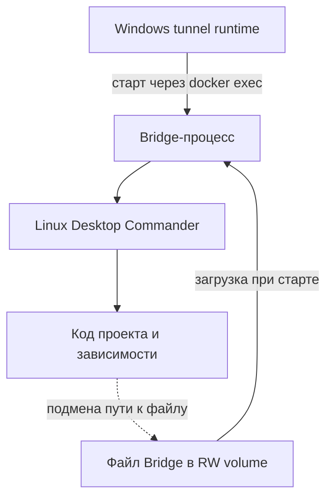

# Fortis Repo: нужен ли MCP Bridge и как выбрать сетевую политику

25 октября 2026 года, Asia/Bangkok. Исследование по прямому запросу пользователя; junction отложены. Существующие решения/план принадлежат [STATE](../STATE.md), общий результат — [обзору защиты](repo-protection-20261025.md). Настройки и работающий туннель не менялись.

## Ответ о Bridge

**MCP Bridge технически не обязателен для файлов и Linux-команд.** Desktop Commander уже является полноценным MCP-сервером. В нынешней схеме Bridge — адаптер presentation/совместимости и stdio-посредник, а не отдельная ОС-граница или обязательный защитный фильтр.

Прочитанный live `/workspace/repo/.fortis/mcp-bridge.mjs` содержит 62 строки и имеет прежний SHA256 `8389436658e22f213d9865a78872159e027ca33094999db64ca96b5a7c79fc21`. Он:

- запускает установленный Linux DC из `/opt/dc/node_modules/@wonderwhy-er/desktop-commander/dist/index.js`;
- передаёт JSON-RPC между туннелем и DC;
- меняет serverInfo/instructions, дополняет описания tools сведениями о Fortis Repo;
- убирает legacy UI metadata/resources; отдельные resources-запросы отвечает сам;
- обычные tools/call передаёт upstream, не добавляя независимую per-call allow/deny политику.



### Что означает найденный риск

Рабочий UID1000 не может записать bytes root-owned файла напрямую, но может менять его writable parent path по проверенным permissions/flags. Это риск замены стартового MCP-обработчика для будущего запуска/переподключения. Подмену не выполняли.

**Дополнительные Windows/root-права от этого автоматически не появляются.** Произвольный Linux-код с тем же UID и так разрешён выбранному workflow. Дополнительный риск — персистентность в служебном входе, подмена tool descriptions/results, сокрытие действий, перехват будущих MCP arguments/responses и отказ сервиса. Действующий уже загруженный процесс не объявляется автоматически изменённым от замены файла.

Это не обнаруженный container escape, чтение Windows key или Windows shell. Системные mounts/UID/capabilities/network остаются той же границей. Защита одного файла не разделяет все процессы/данные общего UID.

Действующие Windows run/control/probe уже сопоставлены по hash с source. Launcher запускает Bridge из RW volume; probe также исполняет его до какого-либо Bridge hash-check. Поэтому hash-проверка, добавленная только после нынешнего probe, будет запаздывать.

### Изолированное сравнение, выполненное сейчас

Запущены два временных Linux MCP-сеанса: напрямую DC и через неизменённый Bridge. У каждого временные HOME/config/cwd, telemetry выключена, отсутствуют credentials; проверены только initialize, tools/list и resources/list. **tools/call внутри этих тестов не отправлялся.** Временные процессы/каталоги очищены; реальные PID137/149 сохранились.

| Параметр | Прямой DC | Через Bridge |
| --- | --- | --- |
| serverInfo | desktop-commander 0.2.52 | fortis-repo 0.2.52 |
| MCP protocol | 2025-03-26 | 2025-03-26 |
| Tools | 26 | 26 |
| Входные схемы tools | Совпали со вторым вариантом для всех 26 | Отличий нет |
| Resources | 2 | 0 |
| Tools с UI metadata | 5 | 0 |
| Capabilities | logging, prompts, resources, tools | logging, prompts, tools |

**PASS(scope): прямой backend поддерживает тот же MCP-интерфейс инструментов.** Не проверены реальные Windows tunnel/client/ChatGPT UI с прямым backend и сами tool operations в этом режиме. Равенство input schemas не является приёмкой всего поведения.

### Две альтернативы для решения

| Proposal | Что сохранить/изменить | Цена и gate |
| --- | --- | --- |
| PR-A-13 / assistant, pending — прямой DC | Windows launcher и probe запускают защищённые image paths `/usr/local/bin/node /opt/dc/node_modules/@wonderwhy-er/desktop-commander/dist/index.js`; startup/presentation проверки учитывают desktop-commander и UI-отличия; Fortis guidance сохраняется в подходящем канале инструкций | Контейнер/образ/mounts можно оставить прежними, если фактическая совместимость подтвердится. Нужны конкретные source changes и отдельная controlled проверка реального клиента с backup/recovery. Сейчас не применено |
| PR-A-07 / assistant, pending — оставить адаптер | Если UI/presentation нужны, поместить Bridge в read-only image path с защищённой цепочкой каталогов; pin проверять до первого исполнения | Потребуются отдельные image/startup changes и проверка. RO-файл под переименовываемым writable parent недостаточен; RO host bind может иметь иные RW aliases |

PR-A-13 — ALTERNATIVE_TO PR-A-07 для одного MCP entry. Не принимать/внедрять оба как обязательный bundle. **Рекомендация:** сначала проверить прямой вариант с реальным клиентом; при достаточной совместимости он убирает этот дополнительный RW startup-компонент и требует меньше перестройки. Если адаптация нужна — оставить её в защищённом месте. F-R-05 остаётся unresolved до реального перехода/защиты и проверки.

Удаление Bridge не решает сеть, широкие data mounts, mutable DC config или общую UID-границу. Нужность read-only core и достаточных входов сохраняется в обоих вариантах. Отдельный Windows-профиль Repo не требуется этим выбором.

## Сеть: что уже установлено и чего ещё нет

Переиспользованы ручной Docker inspect и предыдущие адресные probes. Нового port scan или повторения прежних TCP/HTTPS тестов здесь нет.

| Вопрос | Что известно | Что неизвестно |
| --- | --- | --- |
| Сеть Repo | fortis-repo-egress, bridge, Internal=false, EnableIPv6=false; default route 172.18.0.1 | Реальные Windows/Hyper-V/WFP и Linux VM filtering rules |
| Внешний интернет | GitHub/npm HTTPS HEAD200 ранее подтверждены | Любой ли иной адрес/протокол разрешён; proxy/enterprise фильтры |
| Windows host | Actual runtime health200 через host alias; выбранные admin paths404 | Запрет ненужных host/LAN/control endpoints |
| Docker API | Стандартные 2375/2376 отказали; стандартных sockets в прежнем scope нет | Все альтернативные control routes не исключены |
| IPv6 | В новом адресном чтении /proc/net/ipv6_route нет non-loopback default; Docker network IPv6=false | Полная будущая IPv6/host-proxy политика не доказана |
| Кто меняет ограничения | В Repo CapEff=0; Docker control не выдаётся | Конкретные effective правила на внешнем enforcement слое |

Отдельная bridge-сеть — не выражение «интернет разрешён, Windows/LAN запрещены». Непубликация ports относится к inbound-публикации и не закрывает исходящий host-доступ. Эти различия объясняют [Docker networking](https://docs.docker.com/engine/network/) и [bridge driver](https://docs.docker.com/engine/network/drivers/bridge/).

MCP-транспорт использует Windows runtime → docker exec → stdio. Доступ Repo по TCP к Windows health не является обязательным транспортом MCP. Текущий [Observatory README](../../../observatory/v1/README.md) отдельно описывает Docker loopback archive 18754 и Windows owner Viewer 18755 с owner authorization; доступ агента к архиву не даёт owner API. Новая сеть должна сохранить нужный data flow, не открывая owner API автоматически. Приёмка Observatory не выполнялась.

### Предлагаемый критерий политики — candidate, не новый принятый FR

- Сохранить необходимые внешние downloads/Git/API и DNS для разрешённых задач; требуемые raw TCP/UDP/устройства учитывать по проекту.
- Ненужный Repo→Windows/LAN/control доступ ограничить; нужные локальные сервисы выдавать конкретными исключениями.
- Сохранить необходимые container-local сервисы и существующий MCP/data flow.
- Ограничения должны действовать и для кода/зависимостей, игнорирующих proxy environment variables, и быть вне управления рабочего UID.
- Разрешённый интернет вместе с чтением данных допускает их передачу наружу. Сетевая политика не заменяет границы выданных данных и не является обещанием DLP.

### Где возможно применять ограничения

| Уровень | Применимость / ограничение |
| --- | --- |
| Windows firewall / Hyper-V policy | Сначала получить ActiveStore и определить backend/loopback semantics. Docker Desktop выводит трафик через backend; app-rule может затронуть другие containers/WSL. Нельзя обещать per-Repo scope по одному имени EXE |
| Linux Docker host/VM filtering | Требуются фактическая версия/backend и owner-controlled правила с lifecycle/recovery. Это не shell worker-контейнера; не выдавать ему NET_ADMIN/socket ради настройки |
| Отдельный ограниченный network path/proxy | Возможный отдельный дизайн для per-Repo scope; нужны отсутствие прямого обходного маршрута, поддержка нужных протоколов и проверка. Одних HTTP_PROXY/HTTPS_PROXY недостаточно |
| Просто [--internal](https://docs.docker.com/reference/cli/docker/network/create/) | Убирает обычный внешний маршрут, но меняет интернет-сценарий и не является универсальным запретом host/gateway. Не применяется как готовое решение |

Docker [Desktop networking](https://docs.docker.com/desktop/features/networking/) объясняет backend; [iptables](https://docs.docker.com/engine/network/firewall-iptables/) и [nftables](https://docs.docker.com/engine/network/firewall-nftables/) имеют разные пользовательские hooks. Поэтому готовые DOCKER-USER команды до выяснения фактического backend не предлагаются.

## Недостающие данные для выбора сетевых мер

Подготовлен [Read-RepoNetworkPolicy.ps1](../tools/Read-RepoNetworkPolicy.ps1). Ручной запуск из основной Windows-учётки; сначала обычный PowerShell. Он выводит JSON:

- ActiveStore firewall profiles, связанные Docker/WSL/Tunnel application rules, общие Any/System block rules; generic allows только при outbound-default Block или неизвестных defaults;
- только нужные address/port/service/interface/security constraints, без rule descriptions и raw connection profiles;
- WSL Hyper-V settings/profile/rules с явной отметкой policy store, доступные selected Docker Desktop policy flags, Docker Engine/network metadata;
- local address metadata для понимания host/LAN границы; без process command lines, proxy/PAC URLs, credentials/env/log/payload и имён других containers.

Это чтение metadata, не применение настроек. Ошибки доступа/отсутствующие cmdlets остаются unknown; нельзя трактовать их как отсутствие правил. Не собираются сырые nftables/iptables таблицы Docker VM, third-party WFP/VPN policy и доказательство прохождения каждого flow. Query code/границы проверены; Windows AST/фактический запуск этого нового collector здесь не проверялись.

После JSON можно выбрать узкую применимую схему и подготовить конкретные правила с сохранением функций/откатом. Пока такой вывод о фактических firewall rules не делается. Документация [Get-NetFirewallRule ActiveStore/filter relationships](https://learn.microsoft.com/en-us/powershell/module/netsecurity/get-netfirewallrule) и [Hyper-V firewall](https://learn.microsoft.com/en-us/windows/security/operating-system-security/network-security/windows-firewall/hyper-v-firewall) использована как первичная основа collector.

### Команда ручного сбора

```powershell
& {
    $ErrorActionPreference = 'Stop'
    $fortisScript = 'C:\Users\alexa\Repos\tunnel\docs\agent-workflow\tools\Read-RepoNetworkPolicy.ps1'
    if ((Get-FileHash -LiteralPath $fortisScript -Algorithm SHA256).Hash -ne '5db573a48d0c84b69f8d38fbccdf9170b5de2167f04feff20fcc318d91393801') {
        throw 'Network collector version differs from the prepared version.'
    }
    $fortisJson = & $fortisScript
    $null = $fortisJson | ConvertFrom-Json
    $fortisOutput = Join-Path 'C:\Users\alexa\Workfiles' ('fortis-repo-network-' + [guid]::NewGuid().ToString('N') + '.json')
    $fortisJson | Out-File -LiteralPath $fortisOutput -Encoding UTF8 -NoClobber
    $fortisOutput
}
```

После запуска достаточно сообщить «прогнал» или путь к JSON. Collector не меняет настройки; ошибки доступа нужно вернуть как есть, не повышая права автоматически.

## Scope и gates

Junction отложены пользователем; PR-A-12 не исполняется. Задача текущего этапа — сеть и обоснование нужности MCP Bridge. Native Linux comparison выполнен; сетевой Windows collector подготовлен. PR-A-07/09/13 не применены и не приняты как общий baseline. Ни профили, ACL, mounts, сетевые правила, runtime deployment, Windows/G2, Observatory, ни внешний Git не менялись.
